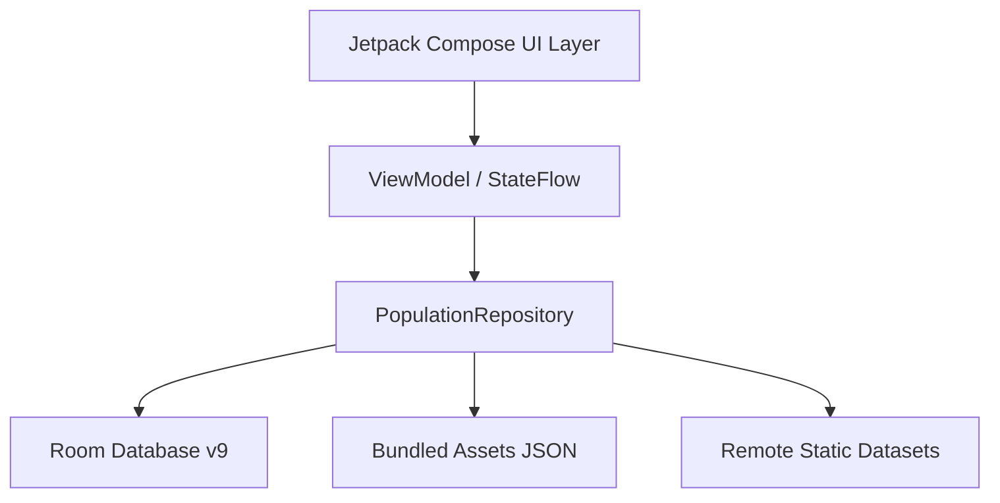

# World Number - System Architecture Document
**Version:** 2.0.0  
**Framework:** Android SDK (API 26-34), Jetpack Compose Material 3, Room, Kotlin Coroutines & Flow, Hilt  

---

## 1. Architectural Layers

### 1.1 Presentation Layer
* **Screen Hierarchy**:
  * `HomeScreen`: 20 category cards, live world population ticker, daily discoveries, quick actions.
  * `CategoryDetailScreen`: Domain hero banner, subcategory grid/list, quick indicator chips, search.
  * `SubcategoryDetailScreen`: Subcategory information, indicator chips, rankings table, comparative bar visualization.
  * `IndicatorDetailScreen`: Full statistical deep dive: value, unit, rank, distribution, country comparison, source methodology.
  * `CountryDetailsScreen`: Holistic profile across demographics, economy, health, education, and geography.

### 1.2 Domain Layer
* Models: `Category`, `Subcategory`, `CategoryIndicator`, `CountryIndicatorValue`, `CountryPopulation`, `WorldPopulation`.
* Repository Interface: `PopulationRepository` defines clean reactive Flows for observing categories, subcategories, indicators, and country statistics.

### 1.3 Data Layer
* Entities:
  * `categories`: id, name, orderIndex, iconKey, headlineStatistic, summary, sourceOrganization
  * `subcategories`: id, categoryId, name, description, orderIndex, iconKey
  * `category_indicators`: indicatorId, categoryId, subcategoryId, name, unit, sortDirection, sourceName
  * `country_indicator_values`: isoCode, indicatorId, categoryId, year, value, formattedValue, globalRank, status
  * `countries` & `country_populations`: ISO-3166-1 alpha-3 code, names, flags, demographics
* Room Database: `AppDatabase` (Version 9) with reactive `Flow` emissions and SQLite parameter-safe chunking (`chunked(250)`).
* Local Seed Sources:
  * `DefaultCategories.kt` (20 items)
  * `DefaultSubcategories.kt` (274 items)
  * `DefaultIndicators.kt` (49 items)
  * `DefaultIndicatorValues.kt` (compact baseline chunks)
  * `assets/data/datasets/*.json` (full 198-country datasets across all 20 categories)
